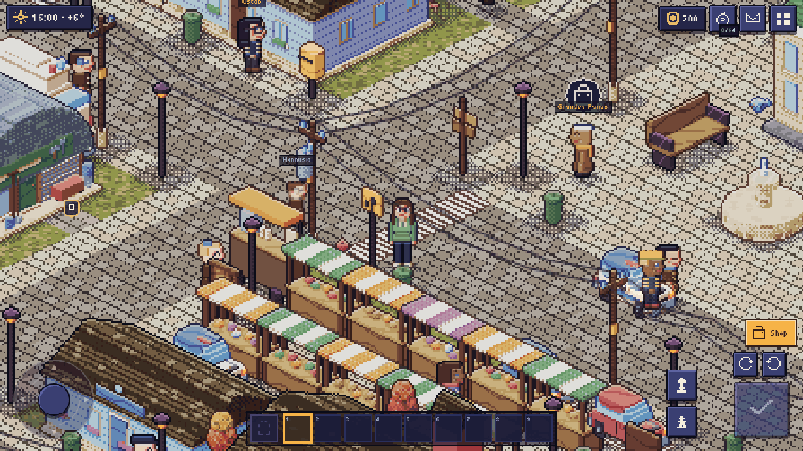
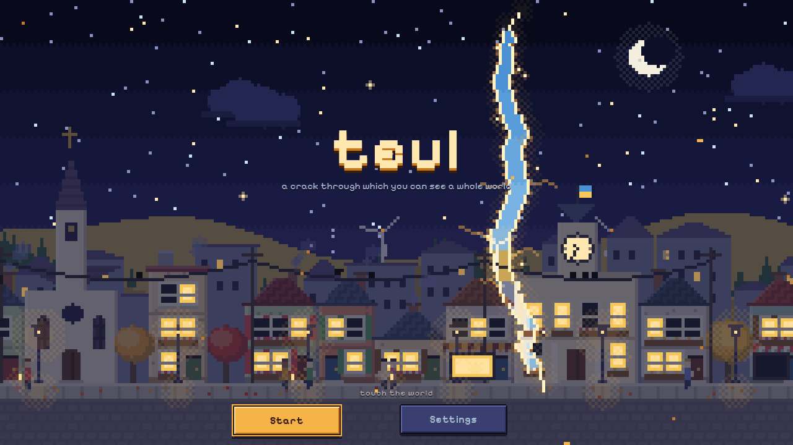
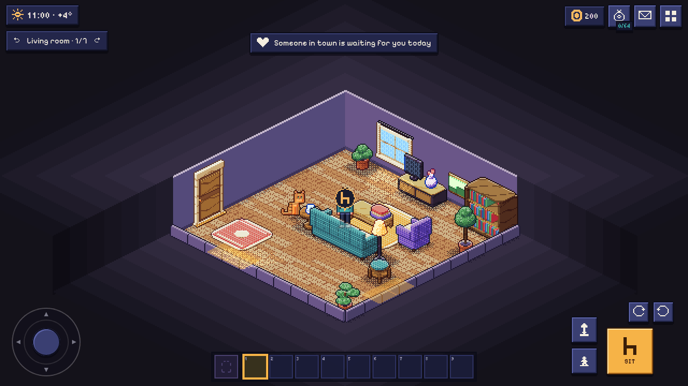
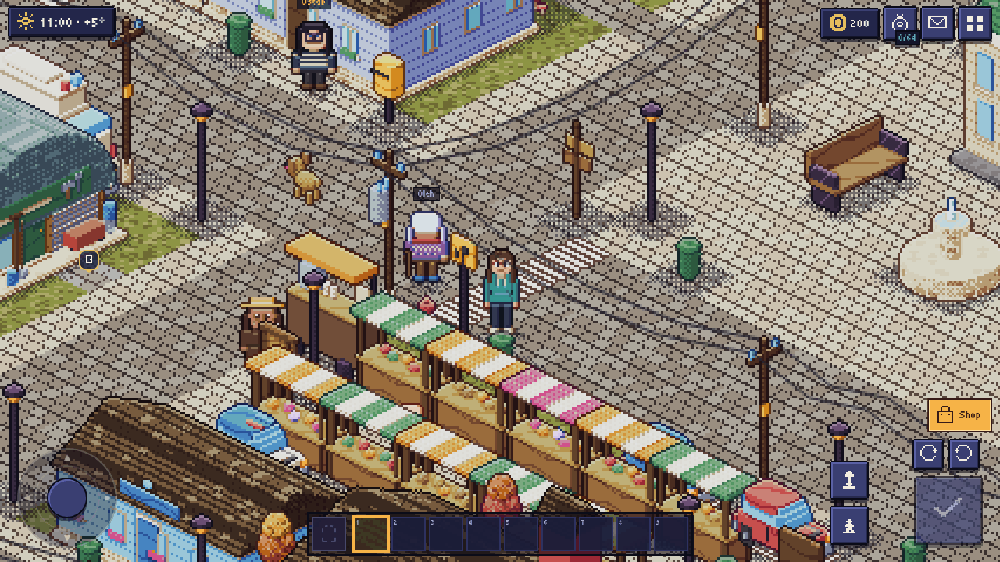
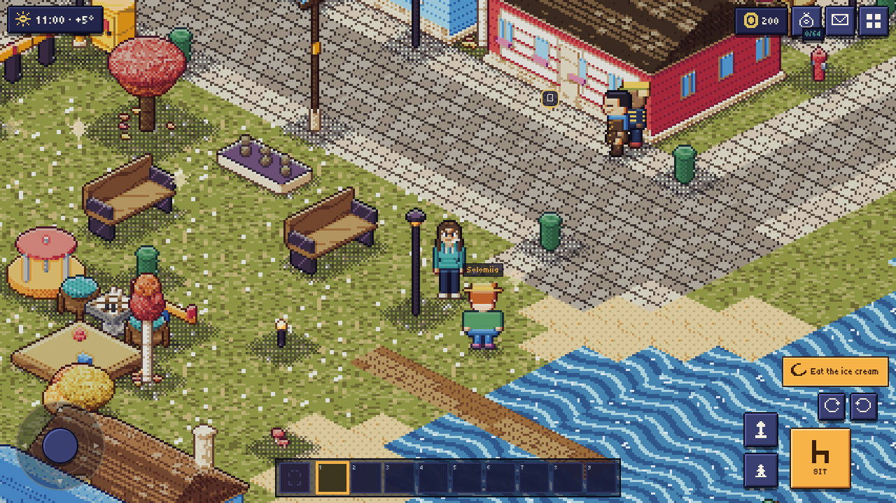
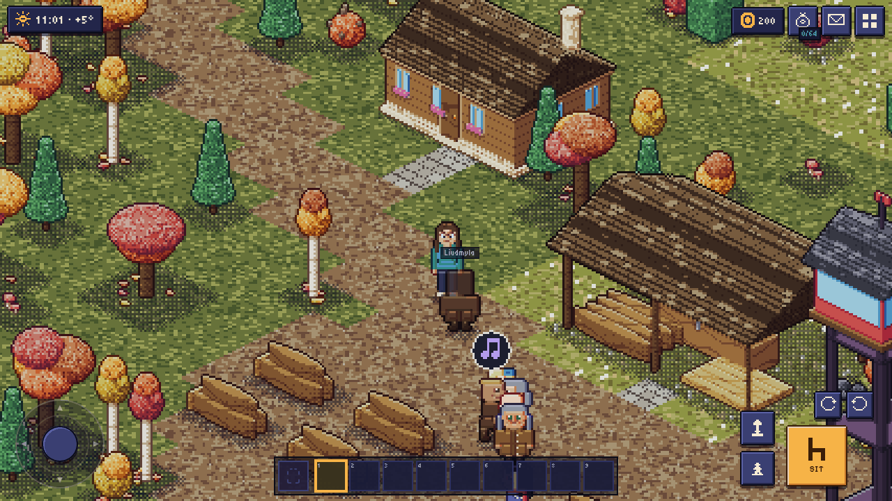
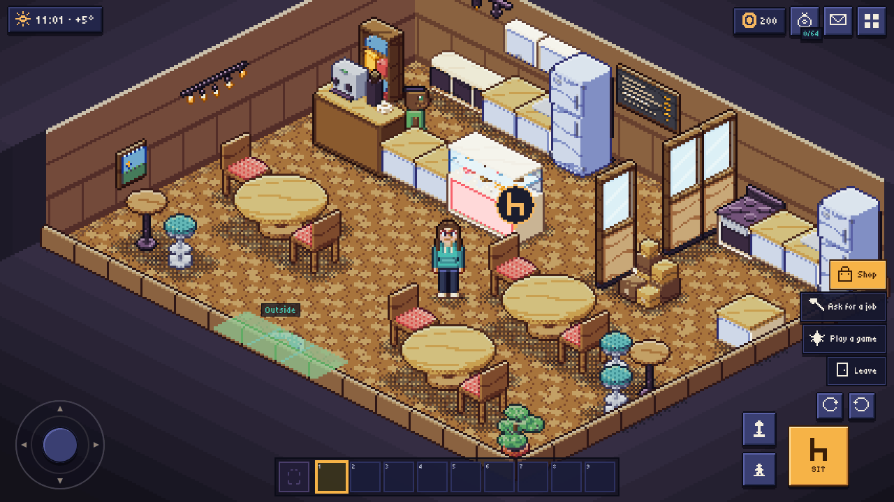
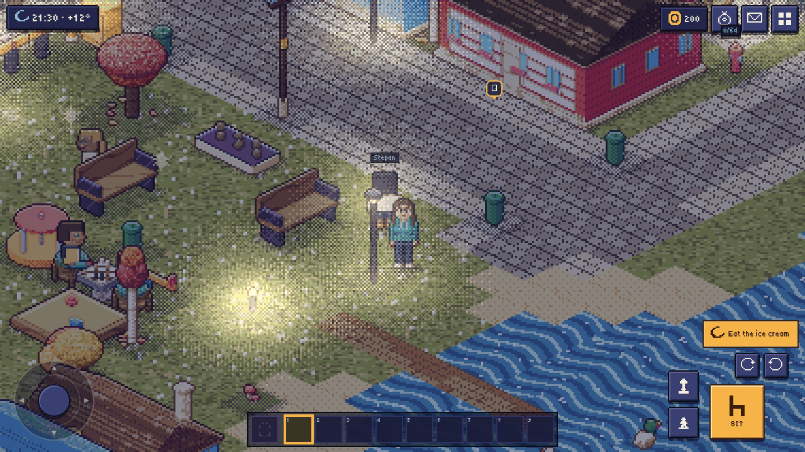

# Teul — Lypove

[Українською](README.uk.md)

[](https://github.com/sashapiscivca-svg/teul/actions/workflows/ci.yml) [](https://github.com/sashapiscivca-svg/teul/actions/workflows/pages.yml)

**A cozy, fully offline life sim in pixel-art isometry.** You move into **Lypove** (Липове), a small Ukrainian town that lives by your device's real calendar and clock: the townsfolk go to work, the market opens in the morning, the lanterns come on at dusk, and the seasons, holidays and full moons are the real ones.

**▶ [Play in the browser](https://sashapiscivca-svg.github.io/teul/)** — no install, no account; your world is saved in the browser.



## Download

| System | File | |
|---|---|---|
| Android 7+ | `teul-<version>.apk` | allow "Install unknown apps" for your browser or file manager |
| Windows 10/11 | `teul-<version>-setup.exe` | SmartScreen: "More info" → "Run anyway" (the installer is not code-signed) |
| Linux | `teul-<version>-x86_64.AppImage` or `teul_<version>_amd64.deb` | AppImage: `chmod +x` and run; needs FUSE |
| Any browser | [play online](https://sashapiscivca-svg.github.io/teul/) | nothing to install |

All files and their `SHA256SUMS` are on the **[latest release](https://github.com/sashapiscivca-svg/teul/releases/latest)** page. A newer version installs over an older one and keeps your world.

## What there is

- **A whole town.** Lypove is a 74×114 map with streets, a square with market stalls, a lake with a beach and a park, and more than thirty interiors to walk into: the school, the hospital, the police station, the café, the bar, the church, the temple, the newsroom, the radio station, the cinema, shops and workshops.
- **Eight maps around it.** The Whispering Forest, the wheat field, the farm, the cemetery, the scrapyard, the hippodrome, the vineyard and the cave — some of them open only once you have earned your way in.
- **Your home.** Start in one room and grow it into a house with a kitchen, a bedroom, a bathroom, a garden and a greenhouse. A full editor for walls, floors, light and furniture, and a pet that lives with you.
- **Townsfolk with lives.** More than a hundred residents with daily schedules, moods, friendships and warmth toward you. They fall ill, grow older, have children, and talk about what happened in town.
- **The newspaper.** “The Lypove Herald” («Липовий вісник») comes every morning with the town's news, photographs and the requests people have for you.
- **Living there.** Shifts at the town's places, a garden that grows over real days, monthly bills at the utility office, cooking at the stove, crafting at a workbench, clothes and the salon.
- **On the road.** The driving school, a licence, your own car, the police camera — and a taxi priced by distance, minutes and demand.
- **Things to do.** Board games, musical instruments and records, the radio and the TV, races at the hippodrome, holidays with their preparations.
- **Rifts.** On the equinoxes and solstices the world cracks open for a day into rift worlds — and in winter into “Lypove inside out” («Липове навиворіт»).
- **Spooky nights** (torch-lit crowds, masked figures, a chase) are **off by default**: they are switched on in the settings, there is no gore, and every scene can be left.
- **Ukrainian and English**, chosen in the settings (the first time by the device's language), and accessibility options: text size, contrast, reduced motion, colour-blind cues, bigger targets, captions.

## Screenshots

| | |
|---|---|
|  |  |
|  |  |
|  |  |
|  | |

## Privacy

Teul is fully offline. There are **no accounts, no servers, no ads, no analytics and no tracking**. Your world lives only on your device (in the browser's IndexedDB, or in the app's storage on Android and the desktop), sealed with a key that never leaves the device's key store. It moves to another device only as an encrypted backup file you make yourself. The Android app asks for no camera, microphone, location or contacts.

## How it is built

- **A deterministic core in Rust** (`crates/teul-core`). Everything that decides an outcome — the economy, the townsfolk, the weather, the calendar — lives in the core, which reads no clock and uses no floating point. The world is an **event log**: each input and its outcome are appended to a hash-chained log, and the same seed, content and log always give the same world. Snapshots make loading fast.
- **WebAssembly.** `crates/teul-wasm` compiles the core to wasm with `wasm-bindgen`; the client talks to it in JSON.
- **A TypeScript client** (`app/`) with a hand-written **Canvas2D isometric renderer**: light and shadows, weather, day and night, and **procedural sprites** — the buildings, people, animals and items are drawn by code, not loaded from image files.
- **Data-driven content.** The town, its maps, items, townsfolk, recipes, quests and texts are generated by Python scripts (`scripts/gen_base_content.py`) into one content pack, `content/base/pack.json`, with an English overlay.
- **Music** is written as code in `crates/teul-music` and recorded offline with a SoundFont into `.ogg` files; the ambience and the sound effects are generated live.
- **Platforms.** The browser (a static site), **Android** through Capacitor and the **desktop** (Windows and Linux) through Tauri v2 — the same web build in all three.

More in [docs/architecture.md](docs/architecture.md) and the [documentation index](docs/README.md).

## Save integrity and compatibility

A save is the event log itself, so nothing can be edited into it unnoticed: on load the core checks the chain and replays every input, and whatever does not follow is left out and reported — it never stops the world from opening. Every new version must open every older save: content ids are never removed, only aliased or *retired*, and golden saves from 1.0 are opened by the test suite on every change. Saves from 1.0.x, which had features this version no longer has, open whole: whatever belonged to the removed parts is passed over and counted as retired. Details: [docs/architecture.md](docs/architecture.md#save-integrity-and-compatibility).

## Build, run and test

You need **Rust** (stable) with the `wasm32-unknown-unknown` target, **wasm-bindgen-cli 0.2.129** (the version in `Cargo.lock`), **Node.js 22.12+** (CI uses 24), **Python 3** to regenerate the content, and **Firefox** for the end-to-end tests.

```bash
# the tools, once (or: bash scripts/install-toolchain.sh, which puts them into .toolchain/)
rustup target add wasm32-unknown-unknown
cargo install wasm-bindgen-cli --version 0.2.129 --locked

# the core
cargo test --workspace

# the client
(cd app && npm ci)
scripts/build-wasm.sh --target web             # the core into app/src/wasm/ (a quick dev profile)
(cd app && npm run dev)                         # http://localhost:5173/
(cd app && npx tsc --noEmit && npx vitest run)  # types and unit tests

# the web version, as published
scripts/build-wasm.sh --target web --release
(cd app && npm run build)                       # → app/dist/, a static site (base './')

# everything: the content, the core, wasm, types, unit tests and the end-to-end suites in headless Firefox
scripts/check.sh --full
```

The Android build (`scripts/build-apk.sh`, with JDK 21 and the Android SDK) and the desktop build (`desktop/`) are described in [docs/release.md](docs/release.md). Test URL flags (`?debug`, `?shift=`, `?lang=`) work only in development builds; see [docs/testing.md](docs/testing.md).

The content pack `content/base/pack.json` (4.4 MB) is generated, but it is committed so that the game builds without Python. After changing anything in `scripts/`, run `python3 scripts/gen_base_content.py` and commit the result; CI checks that the committed pack matches its generator.

## Project layout

| Path | What |
|---|---|
| `crates/teul-core` | The deterministic core: events and the log, rules, content, the town's life, saves and snapshots |
| `crates/teul-wasm` | The WebAssembly bridge (JSON in, JSON out) |
| `crates/teul-music` | The music, written as code, and its offline recorder |
| `app/src` | The TypeScript client: the game loop, the isometric renderer, the procedural pixel art, the interface |
| `app/test`, `app/e2e` | Unit tests (Vitest) and end-to-end suites in headless Firefox |
| `app/public/music` | The recorded music |
| `app/android` | The Capacitor Android project |
| `desktop` | The Tauri v2 desktop app |
| `content/base` | The generated content pack and its English overlay |
| `scripts` | The content generators and checks, the build and release scripts |
| `docs` | The documentation: architecture, content, tests, releases and every system of the world |

## Contributing

Bug reports and pull requests are welcome. Please read [CONTRIBUTING.md](CONTRIBUTING.md) — it asks for a DCO sign-off and explains the licence grant — and the [Code of Conduct](CODE_OF_CONDUCT.md). Security issues: see [SECURITY.md](SECURITY.md). Changes are listed in [CHANGELOG.md](CHANGELOG.md).

## Licence

Copyright © 2026 The Teul authors.

- **Code:** [GNU AGPL-3.0-or-later](LICENSE). If you run a modified version for others, including as a web service, you must offer them its source. The copyright holder may also offer the code under other (commercial) terms.
- **Original content** — the content pack, the world's texts and names, the maps, the music and its recordings, the graphics and the screenshots: [CC BY-NC-ND 4.0](LICENSE-ASSETS.md). You may share it unmodified, with attribution, for non-commercial purposes; anything else needs written permission.
- **The name and the icon** — «Teul», «Теул», «Lypove»/«Липове» as the game's world, the logo and the title art — are licensed under neither: forks and modified builds must use their own name and icon. See [TRADEMARKS.md](TRADEMARKS.md).
- **Third-party material** — the fonts (OFL-1.1) and the dependencies — keeps its own licences: see [THIRD_PARTY_LICENSES.md](THIRD_PARTY_LICENSES.md).

## Credits

Made by **The Teul authors**. Fonts: [Pixelify Sans](https://github.com/eifetx/Pixelify-Sans), [Nunito](https://github.com/googlefonts/nunito) and [Tiny5](https://github.com/Gissio/font_tiny5) (SIL OFL 1.1). The music was recorded with the [GeneralUser GS](https://www.schristiancollins.com) SoundFont by S. Christian Collins through [rustysynth](https://github.com/sinshu/rustysynth). The records in the game are new arrangements of public-domain melodies, among them Mykola Leontovych's «Shchedryk».
